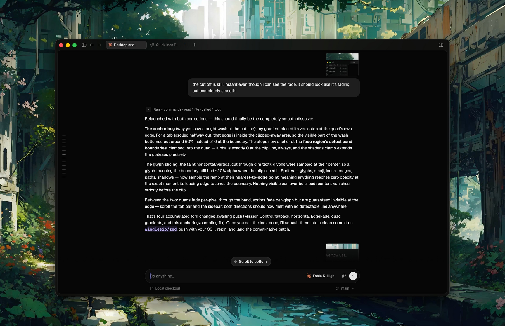

# Komet

Control your coding agents (Claude Code, Codex) from any of your devices.



Every device runs a small engine that keeps your sessions in sync: start an
agent on one machine, follow and drive it from another. Install the engine as
a daemon on an always-on machine (a VPS, a spare box) and your agents keep
working after you close your laptop.

## Install the daemon (Linux)

```bash
curl -fsSL https://komet.komet.sh/install.sh | sh
komet login                          # sign in (paste a code, done)
systemctl --user start komet-native
```

No configuration needed. Day-to-day:

```bash
komet status      # signed in? engine running?
komet update      # update to the latest release
komet daemon start|stop|restart|status
```

On macOS: build `komet` from source, then `komet daemon install` (launchd).

---

Developing or curious how it works? See [ARCHITECTURE.md](ARCHITECTURE.md).

Licensed under the [MIT License](LICENSE).
